 

  

<a href="#-projects"><kbd> &nbsp;🚀 Projects&nbsp; </kbd></a>
<a href="#-tech-stack"><kbd> &nbsp;🧠 Skills&nbsp; </kbd></a>
<a href="#-contact"><kbd> &nbsp;📬 Contact&nbsp; </kbd></a>

 

<table>
  <tr>
    <td align="center"><h1>6</h1>Years of experience</td>
    <td align="center"><h1>~20</h1>Programming languages</td>
    <td align="center"><h1>12+</h1>Client projects delivered</td>
    <td align="center"><h1>2021</h1>Freelancing since</td>
  </tr>
</table>

 

## 🚀 Projects

<table>
  <tr>
    <td width="50%" valign="top">

### 💬 WhatsApp Flight Ticket Assistant
`Sales & support agent`

- ⏱️ Response time **10 min → 30 sec**
- 📉 **90%** less support workload
- 🎙️ Text + voice messages, live flight prices
- 🧑‍💼 Smart handoff to human agents
- 📈 Logging + monitoring dashboard

 

   </td>
    <td width="50%" valign="top">

### 📝 Auto-Grader for Programming Exams
`OCR + Vision + Code runner`

- ⏱️ Grading time **days → minutes**
- 🖼️ Code extracted from images (OCR + vision)
- 🐞 Syntax & logic error detection
- ✅ Runs test cases, auto-scores
- 📋 Evaluation summary per student

 

   </td>
  </tr>
  <tr>
    <td width="50%" valign="top">

### 🏗️ Building Materials Sales Assistant
`RAG + Agent`

- 🎯 Product recommendations from customer needs
- 💰 Collects & analyzes prices from online sources
- 📇 Lead management + user behavior monitoring
- 🤝 Less support staff for repetitive tasks

 

   </td>
    <td width="50%" valign="top">

### 🏋️ Gym Personal Assistant
`Computer Vision`

- 🦴 Pose estimation with **YOLO Pose**
- 📐 Joint-angle analysis in real time
- 🔔 Instant feedback to correct movement
- 🛡️ Lower risk of injury

 

   </td>
  </tr>
</table>

 

## 🧠 Tech Stack

<table>
  <tr>
    <td align="center" width="200"><b>🤖 AI & ML</b></td>
    <td>
      
      
      
      
    </td>
  </tr>
  <tr>
    <td align="center"><b>🧩 Frameworks</b></td>
    <td>
      
      
      
      
      
      
      
    </td>
  </tr>
  <tr>
    <td align="center"><b>⚙️ Backend & APIs</b></td>
    <td>
      
      
      
    </td>
  </tr>
  <tr>
    <td align="center"><b>🗄️ Databases & Vectors</b></td>
    <td>
      
      
      
    </td>
  </tr>
  <tr>
    <td align="center"><b>🛠️ Tools & DevOps</b></td>
    <td>
      
      
      
    </td>
  </tr>
</table>

 

 

## 🎯 Focus

<b>🎓 Education</b>

 

**B.Sc. Computer Engineering** — Islamic Azad University, Mashhad
*In progress · Graduating 2029*

 

## 📬 Contact

  

💡 *Have a business problem? Let's turn it into an AI product.*

